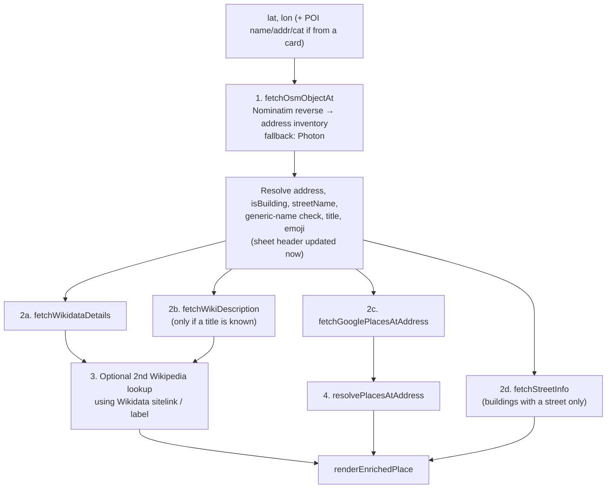

# TellMe — Functional & Technical Specification

## 1. Overview

TellMe is a mobile-first, client-only web app for exploring places on a map. There is no search box. The user either:

- taps a POI card or marker (nearby places come from Wikipedia GeoSearch), or
- taps any point on the map (a building, street, or landmark), which is reverse-geocoded.

For the selected location the app builds a detail sheet from OpenStreetMap (Nominatim/Photon), Wikidata, Wikipedia and, optionally, Google Places. The sheet shows the name, address, construction facts, a narrative, businesses at the address, and context about the street.

There is no backend. The app is a static Vite build deployed to GitHub Pages, and every API call goes straight from the browser.

---

## 2. Architecture

### 2.1 Module layout

| Path | Responsibility |
|---|---|
| `src/main.ts` | Bootstrap, event wiring, orchestration (`handleViewChange`, `handleSelectPOI`, `handleMapClick`, `handleFetchEnrichedPlace`, `handleExploreTerm`) |
| `src/store.ts` | Singleton store (`get` / `update` / `subscribe`) holding `AppState` |
| `src/constants.ts` | Endpoints, limits, timings, element IDs, CSS class names, tile config |
| `src/types.ts` | Shared interfaces |
| `src/map/leaflet.ts` | Map init, POI markers, clicked pin, user dot, `flyTo`, geolocation |
| `src/api/places.ts` | Wikipedia GeoSearch → POIs, category inference, Paris fallback POIs |
| `src/api/osm.ts` | Nominatim reverse/search, Photon fallback, address inventory, OSM parsing |
| `src/api/wikidata.ts` | SPARQL (by QID and spatial), entity search, fact building, building/organisation merge |
| `src/api/wiki.ts` | Wikipedia extracts, location validation, term extraction, country-name helpers |
| `src/api/googlePlaces.ts` | Places Text Search, caching, daily quota, "places at this address" aggregation |
| `src/api/street.ts` | Building detection, street-name extraction, Street Guide lookup |
| `src/api/overpass.ts` | **Legacy name. Makes no Overpass calls.** Holds POI emoji/category/address helpers and `haversineKm` |
| `src/ui/sheet.ts` | Bottom sheet rendering, exploration history, breadcrumb, swipe-to-close |
| `src/ui/cards.ts` | POI card carousel, skeletons, empty state |
| `src/ui/filters.ts` | Category chip wiring |
| `src/ui/dom.ts` | `$`, `$safe`, `esc`, `debounce`, `highlightTerms` |
| `src/ui/toast.ts` | Toast notifications |
| `src/utils/url.ts` | URL coordinate parsing/formatting and hash sync |

### 2.2 Design rules

1. **No Overpass API.** This is a project rule (see `AGENTS.md`). POIs come from Wikipedia GeoSearch, and map objects come from Nominatim, with Photon as the fallback.
2. **State changes go through the store.** Shared app state (`AppState`) changes only through `store.update(partial)`. `subscribe()` exists, but no module uses it at the moment: UI updates are imperative calls made from `main.ts`. Module-level state also exists outside the store: one `AbortController` per API module, plus caches.
3. **Pure parsers.** Response parsers, formatters, URL helpers and distance maths are pure functions that Vitest covers directly.
4. **Request cancellation.** Each API module keeps a single module-level `AbortController`, and a new call aborts the same module's previous in-flight request. There is no per-tap generation token. A superseded pipeline whose early step was aborted can therefore keep going with partial data and render briefly before the newer one finishes (see §9).

### 2.3 Caches

| Cache | Storage | Key | TTL / bound |
|---|---|---|---|
| Nearby POIs (`placesCache`, `main.ts`) | Memory | `lat.toFixed(2),lon.toFixed(2),activeCat` (~1 km buckets) | Session, unbounded |
| Address inventory (`osm.ts`) | Memory | `road_house_city` (lowercased) | Session, unbounded |
| Street Guide (`street.ts`) | Memory | `street|city` (lowercased), including negative results | Session, unbounded |
| Google Places (`googlePlaces.ts`) | Memory + `localStorage` (`gp_cache_<key>`) | `query_lat.toFixed(3)_lon.toFixed(3)` | 24 h |
| Google Places daily counter | `localStorage` (`gp_calls_YYYY-MM-DD`, UTC date) | — | Per day |

Wikipedia and Wikidata responses are not cached.

### 2.4 Key constants (`src/constants.ts`)

| Constant | Value |
|---|---|
| `DEFAULT_CENTER` / `DEFAULT_ZOOM` | Paris `48.8566, 2.3522` / `15` |
| `FLY_TO_ZOOM` | `16` |
| `MIN_ZOOM_FOR_POIS` | `13` |
| `MAX_POIS` | `24` |
| `DEBOUNCE_MAP_MS` | `900` |
| `TOAST_DURATION_MS` | `2800` |
| `GOOGLE_PLACES_MAX_DAILY_CALLS` | `40` |
| `MAP_TILES.MAX_ZOOM` | `19` |
| `SKELETON_COUNT` | `5` |
| `ADDRESS_DESC_LIMIT` | `50` (chars of `description` used as card address when there are no `addr:*` tags) |

---

## 3. Functional Behaviour

### 3.1 Startup and geolocation

- `boot()` hides the About modal, parses URL coordinates, initialises the map, wires listeners and swipe handling.
- **With URL coordinates:** the map opens at those coordinates and zoom, loads nearby places, and runs `handleMapClick` on the coordinates so the sheet opens.
- **Without URL coordinates:** the map opens on Paris at zoom 15, loads nearby places, and calls `locateUser(true)` (silent).
- `locateUser` uses `navigator.geolocation.getCurrentPosition` (`timeout: 8000`, `enableHighAccuracy: true`) and shows `#locating-strip` while it waits. On success the map flies to the user at zoom 15 and adds a `.user-dot` marker. On failure the strip is hidden.
- The 📍 button (`#locate-btn`) calls `locateUser(false)`. Failures produce a toast: *"Geolocation not supported"* or *"Could not get location — showing Paris"*.

### 3.2 URL coordinates

- **Written format:** `#<lat>,<lon>,<zoom>`. Coordinates are rounded to 5 decimals and zoom is clamped to 1–22, e.g. `#48.85837,2.29448,16`.
- **Accepted on parse** (`parseCoordinatesFromUrl`):
  - `#lat,lon[,zoom]`, `#lat/lon/zoom`, `#lat;lon;zoom`, `#@lat,lon,16z`
  - `#lat=..&lon=..[&z|zoom=..]`
  - `?lat=..&lon|lng=..[&z|zoom=..]`
  - Lat/lon are range-checked.
- **Updates use `history.replaceState`.** Selecting a POI or tapping the map replaces the URL hash and does not add browser history entries. Closing the sheet clears the hash (`clearUrlCoordinates`).
- **`hashchange`** fires only when the hash is changed outside the app (manual edit, external link). If coordinates are present, the map flies there and the location is inspected. If they are absent, the sheet closes. The event is ignored while an exploration history exists.
- Deep links are shareable/bookmarkable. Browser back/forward does **not** step through previously inspected places (see §5.3 for term exploration history).

### 3.3 Nearby places (POI discovery)

- `moveend` and `zoomend` share one debounced handler (`900 ms`).
- **Zoom < 13:** the deck shows *"Zoom in more to see places"*. Existing markers are left on the map.
- **Zoom ≥ 13:**
  1. Check `placesCache`. On a hit, render immediately.
  2. Otherwise show skeleton cards and call Wikipedia: `action=query&generator=geosearch&ggsradius=8000&ggslimit=24&prop=coordinates|description|pageimages&pithumbsize=240`.
  3. Map results to POIs. `inferCategory` sets a category from the title and description (see §3.4). Each POI gets the Haversine distance from the **map centre**, the list is sorted by distance, filtered by the active category, and capped at 24.
  4. **No results:** within 0.35° of Paris, show `DEFAULT_PARIS_POIS` (9 curated landmarks, filtered by category). Elsewhere, show *"Move map to a town, city, or landmark to explore"*.
  5. **Request error:** show the Paris fallback if near Paris or if no POIs are loaded yet. Otherwise show *"Could not load places — try moving the map"*. Abort errors are ignored.
- **Markers:** Leaflet `DivIcon` drop pins (`.cm-wrap > .cm-pin > .cm-icon`) with a category emoji. Tapping one selects that POI.
- **Cards** (`.poi-card` buttons in `#cards-scroll`): emoji, name, address line (`addr:street` + house number + city, else the first 50 chars of the description, else coordinates), and a category badge.
- **Selecting a POI** (`handleSelectPOI`):
  - clears the clicked pin, resets history, highlights the card and marker, and scrolls the card into view;
  - flies to the POI at `max(currentZoom, 16)` and updates the URL hash;
  - opens the sheet and runs the enrichment pipeline with the POI's name, address, category and emoji.

### 3.4 Category filters

Chips in `#filter-scroll`, each with a `data-cat` value:

| Chip | `data-cat` |
|---|---|
| 🌍 All | `all` |
| 🏛️ Sights | `tourism` |
| 🏰 Historic | `historic` |
| ☕ Food | `amenity` |
| 🌿 Parks | `leisure` |
| 🛍️ Shops | `shop` |

Tapping a chip updates `.active` / `aria-pressed`, sets `activeCat` in the store, and re-runs the nearby-places query. Categories are inferred from keywords in the Wikipedia title and description (`inferCategory`). Examples:

- church / cathedral / abbey → `historic`
- castle / palace → `historic`
- monument / memorial → `historic`
- museum / gallery → `tourism`
- park / garden / square → `leisure`
- café / restaurant / bistro → `amenity`
- market / shop → `shop`
- tower / bridge / viewpoint → `tourism`
- anything else → `tourism/attraction`

### 3.5 Tapping the map

`handleMapClick(lat, lon)`:

1. Replaces the previous clicked pin with a pulsing 🎯 pin (`.clicked-pin-wrap`).
2. Clears the active card and marker and resets exploration history.
3. Writes the URL hash with zoom `max(currentZoom, 16)`. The map does not move.
4. Opens the sheet with the title *"Inspecting Object…"* and a spinner.
5. Runs the enrichment pipeline (§4).

### 3.6 Other controls

- **Zoom:** `#zoom-in-btn` / `#zoom-out-btn` (Leaflet's own zoom control is disabled).
- **About modal:** `#settings-btn` (ℹ️) opens `#api-modal`. It closes on the "Start Exploring" button (`#api-save-btn`), a backdrop click, or `Escape`. The IDs are left over from the removed API-key dialog.
- **Fullscreen:** `#fullscreen-btn` uses `requestFullscreen` / `webkitRequestFullscreen`. The icon switches between `⛶` and `🗗` and `aria-pressed` is kept in sync. If neither API exists, a toast says fullscreen is unsupported.
- **Toasts:** `#toast` (`role="status"`, `aria-live="polite"`), shown for 2.8 s.

---

## 4. Enrichment Pipeline (`handleFetchEnrichedPlace`)



Steps 2a–2d run in parallel with `Promise.all`. Any one of them can fail, logging a `console.warn`, and the render still happens. If the OSM step fails, the pipeline continues with `osm = null` and uses the coordinates as the address.

### 4.1 Title and address resolution

- **Address:** `formatOsmAddress(osm)` gives `"<house> <road>, <city>, <country>"`. If that fails, the POI address is used, then `"lat, lon"`.
- **`isBuilding`** (`isBuildingFeature`) is true if any of these hold:
  - category or type is `building`;
  - there is a house number;
  - `building=*` (not `no`), `addr:housenumber`, `building:levels` or `building:use` is set;
  - the OSM type is one of `apartments`, `house`, `residential`, `commercial`, `office`, `retail`, `hotel`, `dormitory`, `school`, `civic`, `hospital`, `detached`, `terrace`, `barracks`.
- **Generic name** (`isGenericName`): empty names, placeholders (`building`, `house`, `yes`, `roof`, `unnamed`, `map object`, `place`, …), `node|way|relation/<id>`, bare house numbers, or a name equal to the street name.
  - If the name is generic, the address becomes the sheet title and the address row is hidden.
  - Otherwise the name is the title and `📍 <address>` appears below it.
- **Inputs for the parallel calls:**
  - Wikidata gets coordinates and name only when the name is not generic.
  - The Google Places query is the name, or the address when the name is generic.
  - The first Wikipedia title is the OSM `wikipedia` tag (English only; `en:Title` → `Title`, other languages → ignored), else the non-generic name.

### 4.2 OpenStreetMap (`src/api/osm.ts`)

- **Reverse geocoding:** `nominatim.openstreetmap.org/reverse?format=jsonv2&extratags=1&namedetails=1&addressdetails=1&zoom=18&email=tellme-app@explore.local`.
- **Address inventory** (`fetchAddressInventory`): runs when the reverse result has both a road and a house number. It calls `nominatim.openstreetmap.org/search?street=<house road>&city=<city>&limit=25` with extratags and namedetails, then:
  - picks a **primary** feature, preferring a named `way` that is a mall, department store, shop or building, then any building `way`, then `place=house|building`;
  - collects **organisations**: other named items whose category is `shop|amenity|office|craft`, whose type is in a list of common business types, or which carry an `operator` tag;
  - also lists the originally tapped feature as an organisation if it was a shop or amenity and is not already included.
- **`mergeWithAddressPrimary`**: decides whether the tapped feature or the primary feature supplies the name and metadata.
  - A tapped feature counts as a landmark if its category is `historic` or `tourism`, or it has a `wikidata`/`wikipedia` tag. A landmark is kept unless the primary has a real name or its own `wikidataId`.
  - If only the tapped feature has a specific name, it is kept and the primary fills gaps (`localName`, `wikidataId`, `wikipedia`, `startDate`).
  - Otherwise the primary wins, keeping the tapped coordinates.
- **Photon fallback** (`photon.komoot.io/reverse?lat&lon`): used when Nominatim returns non-OK, fails on the network, or returns nothing parseable. There is no explicit timeout. Photon results carry no extratags, so there is no `wikidataId`, `wikipedia`, `startDate` or `countryCode`, and no address inventory.
- **Parsed fields (`OsmFeature`):**
  - **name:** `name:en`, then `name`, then the address POI fields, then the road (only when there is no house number), then the first segment of `display_name`, then `"Map Object"`.
  - **`localName`:** the native `name` when it differs from `name`.
  - **address:** road, house number, suburb/neighbourhood/quarter, city/town/village, country, `countryCode`, postcode.
  - **`wikidataId`:** first available of `wikidata`, `subject:wikidata`, `operator:wikidata`, `brand:wikidata`, `architect:wikidata`.
  - **`wikipedia`:** first available of `wikipedia`, `wikipedia:en`, `operator:wikipedia`, `brand:wikipedia`.
  - **`startDate`:** first available of `start_date`, `year_of_construction`, `construction_date`, `opening_date`.
- **Emoji:** `inferOsmEmoji` matches keywords in the category and type (church, castle, museum, park, café, shop, building, bridge, …).

### 4.3 Wikidata (`src/api/wikidata.ts`)

Resolution order in `fetchWikidataDetails`:

1. **By QID** (OSM tag or POI). A SPARQL query on `query.wikidata.org/sparql` (`LIMIT 25`, label languages `en,fr,es,de`) fetches:

   | Property | Meaning |
   |---|---|
   | `P571` | Inception, with precision |
   | `P1619` | Opening date |
   | `P2048` | Height |
   | `P84` | Architect |
   | `P149` | Style |
   | `P138` | Named after |
   | `P1435` | Heritage status |
   | `P31` | Instance of |
   | `P186` | Material |
   | `P18` | Image |
   | — | English Wikipedia sitelink |

   If the place is a building and the entity looks like an organisation (`isOrganizationEntity`) or has no inception date, a spatial query looks for the physical building as well (`preferPhysicalBuilding`, ≤ 45 m). Its data is merged in with `mergeBuildingDetailsIntoEntity`.
2. **Spatial** (`wikibase:around`, radius **120 m**, `ORDER BY ?distance LIMIT 20`, labels `en,fr`). The first entity that passes these filters is used:
   - Items whose `P31` matches a country, state, region, city, municipality, settlement, diocese or empire are skipped. For buildings, streets and roads are skipped too.
   - If a specific name is known, results are capped at **45 m**, and the label must match the name or `localName` (diacritic-insensitive). Without a match, the result is kept only as a building candidate.
   - For buildings, physical structures win over organisations that have no physical instance type.
3. **Name search** (`wbsearchentities`, `limit=5`) with `WikidataSearchContext` (`localName`, `city`, `country`, `countryCode`):
   - Pick the first hit whose label or description mentions the city or country (diacritic-normalised; `latvia` also matches `latvi…`).
   - If none does, retry with `localName`, then `"<name> <Country>"` (or `"<name> <city>"`).
   - The first unconstrained hit is accepted only when there is no location context and the hit is not a generic class ("ministry of a government", "type of", …).
   - The found QID is resolved through step 1 and merged with any spatial building candidate.

**Formatting and cleanup**

- `formatConstructionDate`:
  - precision 7 → "13th century"; precision 8 → "1780s";
  - BCE years are supported;
  - `YYYY-01-01` and `YYYY-00-00` → `YYYY`; full dates → "January 28, 1887".
- At most two distinct inception values are shown, joined with " / ".
- An inception of `1201` (Riga's founding year, attached to buildings by a bot import) is dropped for buildings.
- `MONUMENT_METADATA_OVERRIDES` holds manual fixes. Currently one entry: `Q56052108` (Grēcinieku iela 28) → `1780 (rebuilt 1896)`, architect Karl Johann Felsko.
- Images become HTTPS `Special:FilePath` URLs with `?width=800`. Labels that are bare QIDs are discarded.

**`buildInterestingFacts`** produces sentences in this order:

1. Building construction date or establishment date (or construction start plus opening date)
2. Height
3. Architects
4. Styles
5. Named after
6. Materials
7. Heritage status
8. Instance-of classes
9. The entity description, if there are fewer than 2 facts so far

### 4.4 Wikipedia narrative (`src/api/wiki.ts`)

- **Request:** `en.wikipedia.org/w/api.php?action=query&prop=extracts|pageimages|links|coordinates&exintro=1&explaintext=1&pllimit=80&plnamespace=0&pithumbsize=600&redirects=1`.
- **`cleanWikiExtract`:** strips pronunciation and foreign-language parentheticals (e.g. `(Latvian: …; German: …)`), collapses whitespace, keeps up to **3** paragraphs longer than 20 chars.
- **`isGenericOrWrongLocationArticle`** rejects an article when:
  - it is a disambiguation page;
  - its coordinates are more than 0.25° lat or 0.35° lon from the tapped point;
  - it opens with a generic definition ("A … is a …") and does not mention the local city, country or `localName`;
  - location context exists and the article never mentions the city, country (English or native) or `localName`.
- **Retries:** if the direct title is rejected or missing and context exists, these titles are tried in order. The first one that passes validation wins:
  1. `"<t> (<Country>)"`
  2. `"<t> of <Country>"`
  3. `"<t> of the Republic of <Country>"`
  4. `"<t> (<city>)"`
  5. `"<t>, <city>"`
  6. `localName`

  If none passes, no narrative is shown.
- **Second lookup (`main.ts`):** if Wikidata returns an English sitelink (or a non-generic label) that differs from the first title, and either the first lookup failed or the result title differs from the sitelink (with no explicit OSM `en` tag), that title is fetched and replaces the result.
- **Narrative fallback:** Wikipedia extract, then Wikidata description (only for non-generic names), then the OSM `description` tag. A description that just repeats the address of a generic building is dropped.
- **Hero image:** Wikipedia thumbnail, else Wikidata `P18`.
- **Terms** (`extractMatchingTerms`): up to 6 page-link titles (3–40 chars, trailing parenthetical removed) that appear in the text, longest first. If fewer than 3 match, capitalised multi-word phrases are added.
- **`highlightTerms`:** escapes the text, then wraps matches longest-first in `<span class="term" role="button" tabindex="0" data-term="…">`. A `Uint8Array` coverage mask marks used positions, so spans never overlap or nest.

### 4.5 Google Places (`src/api/googlePlaces.ts`)

- **Request:** `POST places.googleapis.com/v1/places:searchText` with body `{ textQuery, maxResultCount: 8, locationBias: circle(lat, lon, 60 m) }`.
- **Field mask:** `places.id, displayName, formattedAddress, primaryType, primaryTypeDisplayName, currentOpeningHours.openNow, websiteUri, editorialSummary`.
- **Skipped** when the query is shorter than 3 chars or equals `Map Object`.
- **Order:** memory/`localStorage` cache, then the quota check, then the network call. The counter goes up only on HTTP-OK responses. When the quota is exhausted, the call returns empty with a console warning.
- **Parsing:**
  - The first result becomes `GooglePlaceDetails`: name, `openNow`, `websiteUri` (only if it starts with `http`), formatted address, editorial summary.
  - All results become `AddressPlaceOrganization` entries.
- **Display policy:** ratings, reviews, price level and phone numbers are never requested or shown.
- **API key:** at `HEAD`, `GOOGLE_PLACES_API_KEY` is hardcoded in `src/constants.ts` and ships in the public bundle (see §9).

### 4.6 Places & organisations at the address (`resolvePlacesAtAddress`)

Entries are merged in this order:

1. OSM address-inventory organisations
2. Google results whose `formattedAddress` contains the inspected road and house number (whole-word match)
3. Loaded POIs within 40 m with a `shop`, `amenity`, `office`, `craft` or `operator` tag
4. The OSM `brand` / `operator` tag

Entries are dropped when:

- the name (case-insensitive) duplicates an earlier entry or matches the primary place name;
- the normalised website matches the primary place's website or an earlier entry's;
- the name is just the building's own address, e.g. `"<road> <house>"` or a building-type entry naming the road.

### 4.7 Street Guide (`src/api/street.ts`)

- **When:** only for buildings with a street name. `extractStreetName` uses the OSM road or `addr:street`, else parses the address string. It ignores names under 3 chars and generic roads (`path`, `track`, `footway`, …).
- **Lookup steps:**
  1. Wikidata `wbsearchentities` (`limit=7`). Prefer an item whose description contains a street-type word and the city (diacritic-normalised). Reject items whose description places them in a different city. Get the `enwiki` sitelink via `wbgetentities`.
  2. Wikipedia extract for the sitelink, then the bare street name (disambiguation pages skipped).
  3. Wikipedia full-text search fallback for `"<street> <city>"` (`gsrlimit=4`). The result title must contain the street name.
  4. If there is no article, use the Wikidata description, but only if it is longer than 60 chars.
- **Output** (`StreetInfo`): name, Wikidata description as subtitle, highlighted description, thumbnail, Wikipedia URL, QID.
  - `inceptionDate`, `length` and `namedAfter` exist on the type but are **never filled**.
  - The street request is not cancellable.
- **Rendering:** the block appears only when there is a thumbnail or at least 40 chars of plain text.

---

## 5. User Interface

### 5.1 Layout and theme

- Dark translucent panels (`backdrop-filter: blur(…)`) with a blue/amber accent. Font: Google Fonts *Outfit* (300–800).
- `viewport-fit=cover`. Safe-area insets are applied to `#top-bar`, `#logo`, the card deck and `#sheet-body`.
- **Mobile (default):** full-width bottom sheet, `max-height: 78dvh`, with a drag handle. The card carousel scrolls horizontally.
- **≥ 640 px:** the sheet and card deck are 380 px wide and anchored bottom-right; sheet `max-height: 70vh`.
- **Landscape:** the logo moves bottom-left, filter chips share the top row with the action buttons, and zoom controls sit under the actions.
- **≤ 380 px:** compact sizing.
- `#sheet-back` and `#sheet-close` are 44×44 px.

### 5.2 Detail sheet (`#desc-sheet`)

When the sheet opens, `#cards-wrap` is dimmed. Contents, top to bottom:

1. **Drag handle** (`#sheet-drag-handle`): dragging down more than 90 px closes the sheet. Ignored while the body is scrolled.
2. **Header:**
   - back button (visible when exploration history is non-empty);
   - title;
   - address row `#sheet-address` (`📍 …`). The display version drops postcode-like segments from long addresses and keeps 3 segments. Tap or Enter copies the full address to the clipboard and shows a toast;
   - subtitle `"<emoji> <category>"`. A short narrative (< 45 chars, no terminal punctuation) is appended here instead of shown in the body;
   - close button.
3. **Breadcrumb** (`#breadcrumb`): one button per history entry. Tapping one restores that entry.
4. **Body** (`#sheet-desc`):
   - **Hero image** (`.sheet-hero-img-wrap`): tap, Enter or Space toggles `.expanded` (uncropped).
   - **Editorial summary** (Google).
   - **"🌐 Visit Website ↗"** button (Google `websiteUri`).
   - **Facts grid** (`.facts-grid`):

     | Card | Source / rule |
     |---|---|
     | Status | Open Now / Closed |
     | Date | Wikidata inception or OSM `startDate`. Labelled **Date of Construction**, or **Established** for organisations (`inferInceptionLabel`) |
     | Opened to Public | Only when different from the date card |
     | Height | — |
     | Architect / Builder | Architects only |
     | Architectural Style | — |
     | Named In Honor Of | — |
     | Heritage Status | — |
     | Construction Materials | — |

   - **Interesting Facts** (`.facts-section-box`):
     - all facts when the grid is empty;
     - when the grid has cards, only a building-construction sentence, and only if a separate `buildingConstructionDate` exists or the place is a building labelled *Established*;
     - otherwise hidden.
   - **Narrative** (`.sheet-narrative-section`): the first paragraph is visible; the rest sit behind **"Read more ▾ / Show less ▴"**. Terms appear as tappable `.term` pills.
   - **Places & Organizations at this Address:** each entry shows name, category, open/closed badge, description and website link.
   - **Street Guide** (`.sheet-street-block`): title, subtitle, image, narrative, and an "Explore … on Wikipedia ↗" link.
5. **Errors:** `renderError` shows `⚠️ <message>` and a hint to try another object.

**Closing the sheet** (close button, swipe, cleared hash) resets `activeIdx` and history, removes highlights and the clicked pin, and clears the URL hash.

### 5.3 Term exploration

Tapping a term (click, Enter or Space):

1. Pushes `{title, subtitle, address, html}` onto `store.history` and calls `history.pushState({tellmeTerm}, '', currentHash)`.
2. Sets the header to the term with subtitle *"🔍 exploring concept"*, hides the address, scrolls the body to the top, and shows the back button and breadcrumb.
3. Runs `fetchWikiDescription(term)` (no location context) and `fetchWikidataDetails({ name: term })` in parallel. If the Wikipedia lookup fails, the Wikidata sitelink is tried.
4. Renders the first result that exists, in this order:
   1. Wikipedia narrative (`renderDesc`: image + narrative + terms)
   2. Wikidata description/facts as a "💡 Explored Concept" sheet
   3. *"Could not find details for …"*

Going back:

- **Back button / breadcrumb:** restores the saved HTML without re-fetching.
- **Browser or hardware back** (`popstate`): goes back one step if history exists. Otherwise it closes the sheet when the URL has no coordinates.
- The in-app back button and breadcrumb do **not** call `history.back()`, so pushed browser entries pile up (see §9).

### 5.4 Keyboard and accessibility

- Filter chips, cards, breadcrumb items and buttons are native `<button>`s. Cards also handle Enter explicitly.
- Terms, the hero image and the address row have `role="button"`, `tabindex="0"`, and respond to Enter or Space (the address row) or Enter (terms).
- `Escape` closes the About modal only. It does not close the sheet.
- The map has an `aria-label`, and the zoom buttons sit in a labelled group.

---

## 6. Data Model

### 6.1 `AppState` (`src/types.ts`, all fields `readonly`)

```typescript
interface AppState {
  map:           LeafletMap | null;
  userMarker:    Marker | null;
  clickedMarker: Marker | null;
  markers:       Marker[];
  pois:          POI[];
  activeCat:     string;          // 'all' | 'tourism' | 'historic' | 'amenity' | 'leisure' | 'shop'
  activeIdx:     number;          // -1 = none selected
  history:       HistoryEntry[];  // { title, subtitle, address?, html }
}
```

### 6.2 Main types

- **`POI`**: extends `OverpassElement` (legacy name) with `tags` (`name`, a category key, `description`, optional `image`, `addr:*`), `_lat`, `_lon`, and `_dist` (km from the map centre at query time).
- **`OsmFeature`**:
  - `osmId`, `osmType`, `name`, `localName?`, `category`, `type`, `displayName`;
  - `address { road, houseNumber, suburb, city, country, countryCode, postcode }`;
  - `tags`, `wikidataId?`, `wikipedia?`, `startDate?`, `lat`, `lon`, `addressOrganizations?`.
- **`WikidataFactDetails`**:
  - `qid`, `label`, `description`;
  - `inceptionDate?`, `buildingConstructionDate?`, `openingDate?`, `height?`;
  - `architects[]`, `styles[]`, `namedAfter[]`, `heritage[]`, `instances[]`, `materials[]`, `interestingFacts[]`;
  - `imageUrl?`, `wikipediaTitle?`, `wikipediaUrl?`.
  - The Construction/Established label is computed in the UI and is not stored here.
- **`GooglePlaceDetails`**: `id?`, `name?`, `openNow?`, `websiteUri?`, `formattedAddress?`, `editorialSummary?`.
- **`AddressPlaceOrganization`**: `id?`, `name`, `category?`, `openNow?`, `websiteUri?`, `formattedAddress?`, `description?`, `source?` (`google | osm | wikipedia`).
- **`StreetInfo`**: `name`, `title?`, `subtitle?`, `descriptionHtml?`, `rawDescription?`, `thumbnail?`, `terms?`, `namedAfter?`, `inceptionDate?`, `length?`, `wikipediaUrl?`, `wikidataId?`, `source?`.
- **`EnrichedPlaceInfo`**: the sheet render input.
  - `name`, `subtitle`, `category`, `emoji`, `lat`, `lon`;
  - `address?`, `isBuilding?`, `streetName?`, `streetInfo?`, `placesAtAddress?`;
  - `osm?`, `wikidata?`, `googlePlace?`;
  - `descriptionHtml?`, `terms`, `thumbnail?`, `distanceKm?`.

---

## 7. External Services

| Service | Endpoint | Used for | Notes |
|---|---|---|---|
| OSM tiles | `tile.openstreetmap.org/{z}/{x}/{y}.png` | Base map | OSM tile usage policy applies |
| Nominatim | `/reverse`, `/search` | Reverse geocoding, address inventory | Approved. Policy: ≤ 1 req/s, identifiable client. Each building tap makes 2 requests |
| Komoot Photon | `/reverse` | Fallback geocoding | Approved |
| Wikipedia API | `en.wikipedia.org/w/api.php` | GeoSearch, extracts, images, links, search | Approved. English only |
| Wikidata API | `www.wikidata.org/w/api.php` | `wbsearchentities`, `wbgetentities` | Approved |
| Wikidata Query Service | `query.wikidata.org/sparql` | Entity facts, spatial lookup | **Not on the approved list in `AGENTS.md`** (see §9) |
| Google Places (New) | `places.googleapis.com/v1/places:searchText` | Summary, open status, website, co-located places | Approved. Cached, 40 calls/day per browser |
| Overpass API | — | **Not used (forbidden)** | — |

---

## 8. Security

- **Escaping:** dynamic text from APIs goes through `esc()` (`& < > " '` → entities) before it is inserted with `innerHTML`. `highlightTerms` escapes the text before adding spans.
- **Website URLs:** Google `websiteUri` is accepted only when it starts with `http`, and is escaped in `href`.
- **External links** use `target="_blank" rel="noopener"`.
- **History restore** re-inserts HTML that the app itself rendered earlier.
- **Known gaps:** see §9.

---

## 9. Known Issues & Limitations

1. **Exposed Google API key (committed code):** the key is hardcoded in `src/constants.ts`, published in the Pages bundle, and present in git history.
   - The `localStorage` quota is per browser, so it does not protect the key.
   - The key should be restricted in Google Cloud Console (HTTP referrer, Places API only, quota) and rotated.
2. **WDQS is not an approved source** under `AGENTS.md`. Either add it to the list or move to `wbgetentities`.
3. **Unescaped Street Guide fallback:** when only a Wikidata description is available, `fetchStreetInfo` puts it into `<p>…</p>` without `esc()`.
4. **Stale pipeline renders:** per-module abort controllers plus `.catch(() => null)` let a superseded tap keep going with null data. The Street Guide request is never aborted.
5. **Co-located POIs use the wrong reference point:** the 40 m check uses `_dist` measured from the map centre, not from the tapped point.
6. **`architect:wikidata` fallback:** it can set the place's `wikidataId` to the architect (a person).
7. **Browser history:**
   - The in-app back button and breadcrumb leave pushed history entries behind.
   - Inspected places use `replaceState`, so back/forward does not move between them.
8. **English only:** all lookups use `en.wikipedia.org`. Country-name mapping (`COUNTRY_CODE_TO_ENGLISH`) covers about 30 mostly European countries.
9. **Photon fallback is thin:** no tags, no Wikidata/Wikipedia links, no country code, no address inventory.
10. **No request timeouts** on any fetch. **No Nominatim/Wikimedia identification headers.** The `email` parameter is a placeholder.
11. **Unbounded caches:** the in-memory caches have no size limits.
12. **Stale meta description:** the `<meta name="description">` in `index.html` still says "AI-powered".

---

## 10. Build, Test & Deploy

### 10.1 Tooling

- **Stack:** Vite 5, TypeScript 5, Leaflet 1.9 (the only runtime dependency).
- **TypeScript:** `strict`, `noUncheckedIndexedAccess`, `exactOptionalPropertyTypes`, `noImplicitOverride`, `useUnknownInCatchVariables`. Target ES2022.
- **`vite.config.ts`:** `base: './'` so the build works under any subpath (GitHub Pages repo path). `@` → `/src` alias. Vitest config lives in the same file.

| Script | Command |
|---|---|
| `dev` | `vite` |
| `build` | `tsc --noEmit && vite build` → `dist/` |
| `preview` | `vite preview` |
| `test` / `test:run` | `vitest` / `vitest run` |
| `test:coverage` | `vitest run --coverage` (v8, `src/**/*.ts`, excludes `main.ts`) |

### 10.2 Tests

Vitest + jsdom (`tests/setup.ts`, globals enabled). 137 tests in 11 files:

| File | Tests |
|---|---|
| `tests/api/osm.test.ts` | 10 |
| `tests/api/wikidata.test.ts` | 15 |
| `tests/api/googlePlaces.test.ts` | 9 |
| `tests/api/street.test.ts` | 13 |
| `tests/api/places.test.ts` | 9 |
| `tests/api/wiki.test.ts` | 10 |
| `tests/api/overpass.test.ts` | 20 |
| `tests/ui/sheet.test.ts` | 15 |
| `tests/ui/cards.test.ts` | 6 |
| `tests/utils/dom.test.ts` | 19 |
| `tests/utils/url.test.ts` | 11 |

`main.ts` orchestration and `map/leaflet.ts` have no automated tests.

### 10.3 Deployment (`.github/workflows/deploy.yml`)

- **Triggers:** push to `main`, `workflow_dispatch`.
- **Permissions:** `contents: read`, `pages: write`, `id-token: write`. Concurrency group `pages` (no cancel-in-progress).
- **`build` job:**
  1. checkout (`actions/checkout@v4`)
  2. Node 20 with npm cache (`actions/setup-node@v4`)
  3. `npm ci`
  4. `npm run test:run`
  5. `npm run build`
  6. upload `./dist` (`actions/upload-pages-artifact@v3`)
- **`deploy` job:** `actions/deploy-pages@v4` to the `github-pages` environment.

---

## 11. Uncommitted Work in Progress (not yet reflected above)

The working tree contains a partial refactor that is not committed:

- **`src/constants.ts`:**
  - the Google key moves to `VITE_GOOGLE_PLACES_API_KEY`, with an optional `VITE_GOOGLE_PLACES_PROXY_URL`;
  - adds `VITE_NOMINATIM_EMAIL`, `APP_USER_AGENT`, and per-host minimum intervals (Nominatim 1000 ms, Photon 250 ms);
  - **removes** `WIKIDATA_SPARQL_ENDPOINT`.
- **`src/api/http.ts`** (new): `apiFetch` with a per-host request queue, a Wikimedia `Api-User-Agent` header and Nominatim referrer policy; `anySignal` helper.
- **`src/api/googlePlaces.ts`:** uses `apiFetch`. Google Places is skipped when neither a proxy nor a key is configured, and an external `AbortSignal` is accepted.
- **`src/vite-env.d.ts`** (new): types for the env vars.

`src/api/wikidata.ts` still imports `WIKIDATA_SPARQL_ENDPOINT`, so **the working tree does not type-check until that refactor is finished**. When it lands, update §2.3, §4.3, §4.5, §7 and §9 items 1, 2 and 10.
